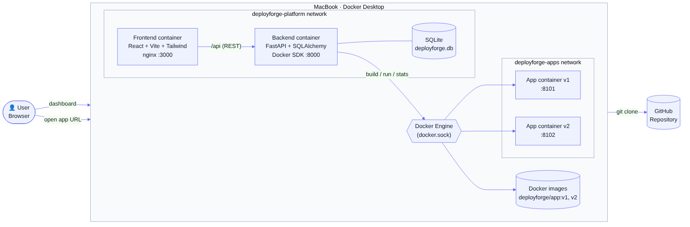
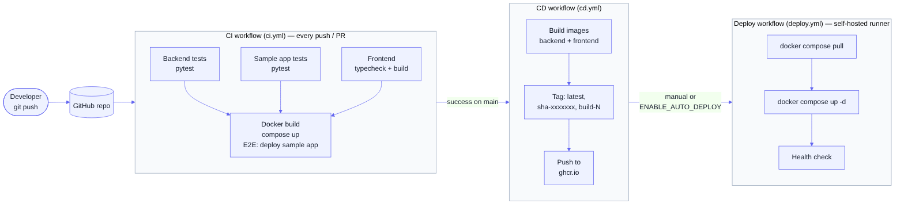

# DeployForge – A Mini Platform as a Service (PaaS)

[](https://github.com/Amrutha8Hasini/Deploy_Forge/actions/workflows/ci.yml)

> Continuous Collaborative Development and DevOps (CDD) project

DeployForge lets you deploy a GitHub project with one click. You give it a
repository URL; it clones the code, detects whether it is a Python or Node.js
app, writes a Dockerfile, builds a Docker image, runs it in a container on your
Mac, checks that it is healthy and shows you the URL. Every successful version
is kept, so you can roll back to an older one.



---

## Contents

1. [Features](#1-features)
2. [Technology stack](#2-technology-stack)
3. [Folder structure](#3-folder-structure)
4. [Execution guide for macOS (step by step)](#4-execution-guide-for-macos-step-by-step)
5. [Deploying the sample application](#5-deploying-the-sample-application)
6. [Docker commands for the examiner](#6-docker-commands-for-the-examiner)
7. [CI/CD with GitHub Actions](#7-cicd-with-github-actions)
8. [Database tables](#8-database-tables)
9. [Security measures](#9-security-measures)
10. [Troubleshooting](#10-troubleshooting)
11. [Limitations and future scope](#11-limitations-and-future-scope)

More documents in [`docs/`](docs/):
[project report](docs/REPORT.md) ·
[team division](docs/TEAM_DIVISION.md) ·
[expo demo script](docs/DEMO_SCRIPT.md) ·
[viva questions](docs/VIVA_QUESTIONS.md) ·
[presentation](docs/DeployForge_Presentation.pptx)

---

## 1. Features

| #   | Module                | What it does                                                                                                                         |
| --- | --------------------- | ------------------------------------------------------------------------------------------------------------------------------------ |
| 1   | Dashboard             | Total apps, successful/failed deployments, running containers, 7-day chart, recent activity, app status                              |
| 2   | GitHub integration    | Repository URL, branch (with "Load branches"), optional Personal Access Token, optional root directory                               |
| 3   | Project detection     | `requirements.txt` → Python (Flask / FastAPI / Django / plain), `package.json` → Node.js. Java is detected and marked as future work |
| 4   | Dockerfile generation | Readable template per type, saved as `Dockerfile.deployforge` and shown in the UI                                                    |
| 5   | Application building  | Real `docker build` through the Docker SDK; every build log line is saved and streamed to the UI                                     |
| 6   | Container management  | List, start, stop, restart and view logs of deployed containers                                                                      |
| 7   | Deployment            | Free host port from 8100–8199, URL like `http://localhost:8101`, "Open application" button                                           |
| 8   | Deployment history    | ID, app, version, commit, date/time, build status, deployment status, URL                                                            |
| 9   | Rollback              | Starts an earlier, known-good Docker image in a new container (not just a status change)                                             |
| 10  | Monitoring            | Running/stopped, CPU %, memory, health check result, recent container logs                                                           |

If a new version fails its health check, DeployForge removes the new container
and **the old version keeps running**.

## 2. Technology stack

| Layer      | Technology                                          |
| ---------- | --------------------------------------------------- |
| Frontend   | React 19, TypeScript, Vite, Tailwind CSS 4          |
| Backend    | Python 3.12, FastAPI (REST API), Uvicorn            |
| Python tooling | uv (virtual environments, dependencies, lock file) |
| Database   | SQLite through SQLAlchemy 2                         |
| Containers | Docker, Docker Compose, Docker SDK for Python       |
| CI/CD      | GitHub Actions, GitHub Container Registry (ghcr.io) |
| Testing    | Pytest (backend and sample app), end-to-end script  |

No Kubernetes, Terraform, Redis or paid cloud services are needed.

## 3. Folder structure

```
Deploy_Forge/
├── backend/                     FastAPI backend (Member 2, 3, 5)
│   ├── app/
│   │   ├── main.py              app start-up, routers, /api/health
│   │   ├── config.py            settings from environment variables
│   │   ├── database.py          SQLite engine and sessions
│   │   ├── models.py            4 tables: applications, deployments, build_logs, deployment_versions
│   │   ├── schemas.py           request/response shapes (Pydantic)
│   │   ├── auth.py              simple login with signed tokens
│   │   ├── routers/             REST endpoints (auth, applications, deployments, containers, monitoring)
│   │   └── services/
│   │       ├── github_service.py        clone, branches, token handling
│   │       ├── detector.py              project type detection
│   │       ├── dockerfile_generator.py  Dockerfile templates
│   │       ├── docker_service.py        Docker SDK: build, run, stop, logs, stats
│   │       ├── health_checker.py        HTTP health checks
│   │       ├── stats.py                 CPU / memory calculation
│   │       └── deployment_service.py    the full deploy + rollback pipeline
│   ├── tests/                   pytest tests
│   ├── Dockerfile
│   ├── pyproject.toml           dependencies (managed with uv)
│   ├── uv.lock                  exact versions of every package (generated by uv)
│   └── .python-version          Python version uv should use (3.12)
├── frontend/                    React dashboard (Member 1)
│   ├── src/pages/               Login, Dashboard, Projects, ConnectRepository, CreateDeployment,
│   │                            BuildLogs, DeploymentHistory, Monitoring, Settings
│   ├── src/components/          Layout (sidebar), icons, badges, small UI pieces
│   ├── src/api.ts               all calls to the backend
│   ├── src/router.tsx           tiny router (no extra library)
│   ├── Dockerfile, nginx.conf
│   └── package.json
├── sample-app/                  Flask app used for the demo
├── .github/workflows/           ci.yml, cd.yml, deploy.yml (Member 4)
├── scripts/                     verify.sh, e2e_test.sh, prepare-offline-demo.sh
├── docs/                        report, diagrams, team division, demo script, viva, PPT
├── docker-compose.yml           starts the platform (backend + frontend)
├── docker-compose.prod.yml      same, but with images from ghcr.io
└── .env.example                 configuration template
```

---

## 4. Execution guide for macOS (step by step)

### 4.1 Install the required software (once)

Open the **Terminal** app (⌘ + Space → "Terminal").

| Software           | Why                                               | Install                                                                                                                             |
| ------------------ | ------------------------------------------------- | ----------------------------------------------------------------------------------------------------------------------------------- |
| Homebrew           | installs the others                               | `/bin/bash -c "$(curl -fsSL https://raw.githubusercontent.com/Homebrew/install/HEAD/install.sh)"`                                   |
| Docker Desktop     | builds and runs containers                        | Download from <https://www.docker.com/products/docker-desktop/> (choose Apple Silicon or Intel), open it, wait for "Engine running" |
| Git                | clone/push code                                   | `brew install git`                                                                                                                  |
| uv                 | Python versions, virtual environments and packages (only for running without Docker / tests) | `brew install uv` (uv downloads Python 3.12 by itself when needed)                                          |
| Node.js 20         | frontend (only for running without Docker)        | `brew install node@20`                                                                                                              |
| VS Code (optional) | editor                                            | `brew install --cask visual-studio-code`                                                                                            |

Check everything (each command should print a version):

```bash
docker --version          # Docker version 27.x or newer
docker compose version    # Docker Compose version v2.x
git --version
uv --version              # uv 0.9 or newer
node --version            # v20.x
```

> Docker Desktop setting: **Settings → Advanced → "Allow the default Docker
> socket to be used"** must be ticked (it is ticked by default). DeployForge
> talks to Docker through `/var/run/docker.sock`.

### 4.2 Get the code

**Terminal 1**, any folder you like:

```bash
git clone https://github.com/Amrutha8Hasini/Deploy_Forge.git
cd Deploy_Forge
git checkout develop        # or main, whichever branch has the latest code
```

### 4.3 Configure the environment

```bash
cp .env.example .env
open -e .env                # opens in TextEdit; change ADMIN_PASSWORD and SECRET_KEY
```

All values have sensible defaults; the platform also works without a `.env`
file (login `admin` / `admin123`).

### 4.4 Option A (recommended): run everything with Docker Compose

**Terminal 1**, folder `Deploy_Forge`:

```bash
docker compose up --build
```

Expected: Docker downloads the base images (first time only, needs internet),
builds `deployforge-backend` and `deployforge-frontend`, and prints logs.
Wait until you see `Uvicorn running on http://0.0.0.0:8000`.

Open:

- Dashboard: <http://localhost:3000> → log in with `admin` / `admin123` (or your `.env` values)
- API documentation (Swagger): <http://localhost:8000/docs>

To run in the background instead: `docker compose up --build -d`
To stop: `Ctrl + C` (or `docker compose down` if started with `-d`).

### 4.5 Option B: run the backend and frontend without Docker (for development)

Use this when you are changing code. Docker Desktop must still be running,
because the backend uses it to build and run the deployed apps. Stop Option A
first (`docker compose down`), because both use port 8000.

**Terminal 1** – backend, folder `Deploy_Forge/backend`:

```bash
cd backend
uv sync                                        # first time: downloads Python 3.12 if needed, creates .venv, installs packages
uv run uvicorn app.main:app --reload --port 8000
```

`uv sync` reads `pyproject.toml` and `uv.lock` and creates the virtual
environment in `backend/.venv`. `uv run` runs a command inside it, so you never
need `source .venv/bin/activate` (you still can, if you prefer).

Expected: `Uvicorn running on http://127.0.0.1:8000`. The SQLite file is created at
`backend/data/deployforge.db`. (In this mode settings come from environment
variables, not from `.env`. To load `.env`: `set -a; source ../.env; set +a`
before `uvicorn`.)

**Terminal 2** – frontend, folder `Deploy_Forge/frontend`:

```bash
cd frontend
npm install
npm run dev
```

Expected: `Local: http://localhost:5173/`. Open it in the browser. Vite forwards
`/api` requests to the backend on port 8000.

### 4.6 Run the tests

**Terminal 2**, folder `Deploy_Forge`:

```bash
# Backend tests
cd backend && uv run pytest -v && cd ..

# Sample app tests (uv makes a temporary environment from requirements.txt + pytest)
cd sample-app && uv run --no-project --with-requirements requirements.txt --with pytest pytest -v && cd ..

# Or everything at once (tests + frontend build + docker images):
./scripts/verify.sh
```

Expected: all tests pass (`passed` in green). `verify.sh` ends with `All checks passed.`

### 4.7 Managing Python packages with uv

| Task | Command (in `backend/`) |
| --- | --- |
| Install everything / update `.venv` after a `git pull` | `uv sync` |
| Add a package | `uv add <package>` (updates `pyproject.toml` and `uv.lock`) |
| Add a development-only package | `uv add --dev <package>` |
| Remove a package | `uv remove <package>` |
| Re-create the lock file after editing `pyproject.toml` by hand | `uv lock` |
| Upgrade all packages within the allowed versions | `uv lock --upgrade && uv sync` |
| Run any command in the environment | `uv run <command>` |

Always commit `pyproject.toml` **and** `uv.lock` together. CI and the backend
Docker image install with `--locked`, so they fail loudly if the lock file is
out of date instead of silently installing different versions.

The **sample app** deliberately keeps a plain `requirements.txt`: it stands for
"a user's project", and `requirements.txt` is what DeployForge's detection
looks for.

---

## 5. Deploying the sample application

The `sample-app/` folder is a small Flask app (homepage, `/health`,
`/api/info`, `/api/greet?name=NIE`). DeployForge can deploy it straight from
this repository using the **Root directory** field.

1. Push this repository to GitHub (the platform clones from GitHub, not from your disk).
2. Dashboard → **Connect Repository**:
   - Repository URL: `https://github.com/Amrutha8Hasini/Deploy_Forge`
   - Branch: `develop` (click **Load** to see branches)
   - Root directory: `sample-app`
   - Token: leave empty if the repository is public; otherwise paste a token (see 7.4)
3. Click **Fetch & detect** → shows the repository name, latest commit,
   **Python / Flask**, and the generated Dockerfile.
4. Click **Save application** → **Deploy**.
5. The **Build Logs** page shows each step live: clone → detect → Dockerfile →
   build (real Docker output) → start container → health check → live.
6. Click **Open application** → the sample app opens at `http://localhost:8100`
   showing **v1.0.0** and the container ID.

### Deploy a new version and roll back

1. Edit `sample-app/app.py`: `APP_VERSION = "2.0.0"` and `THEME_COLOR = "#10b981"`.
2. `git commit -am "feat(sample-app): release v2.0.0" && git push`
3. DeployForge → **Projects** → **Deploy**. Version **v2** starts on a new port; v1's container is stopped.
4. **Deployment History** → select the app → **Roll back to v1**.
   DeployForge starts the stored `v1` image in a new container. The page shows v1 (indigo) again,
   the v2 deployment is marked **Rolled Back**.

---

## 6. Docker commands for the examiner

Run these in **Terminal 2** while the platform is running.

| What to show              | Command                                                                                                       | What you will see                                                              |
| ------------------------- | ------------------------------------------------------------------------------------------------------------- | ------------------------------------------------------------------------------ |
| Images being built        | `docker compose build`                                                                                        | build steps for backend and frontend                                           |
| All DeployForge images    | `docker images \| grep deployforge`                                                                           | `deployforge-backend`, `deployforge-frontend`, `deployforge/<app>:v1`, `:v2` … |
| Platform containers       | `docker ps --filter label=deployforge.role=platform`                                                          | `deployforge-backend`, `deployforge-frontend`                                  |
| Deployed app containers   | `docker ps -a --filter label=deployforge.role=app`                                                            | `deployforge-<app>-v1-d1` etc. with ports `0.0.0.0:8100->8000/tcp`             |
| Logs of the platform      | `docker compose logs -f backend`                                                                              | API requests and deployment activity                                           |
| Logs of a deployed app    | `docker logs <container-name>`                                                                                | gunicorn output of the sample app                                              |
| Live CPU / memory         | `docker stats`                                                                                                | same numbers as the Monitoring page                                            |
| Stop / start / restart    | `docker stop <name>` · `docker start <name>` · `docker restart <name>`                                        | (also possible from the Monitoring page)                                       |
| Security limits of an app | `docker inspect <name> --format '{{.HostConfig.Memory}} {{.HostConfig.CapDrop}} {{.HostConfig.SecurityOpt}}'` | `268435456 [ALL] [no-new-privileges:true]`                                     |
| Networks                  | `docker network ls \| grep deployforge`                                                                       | `deployforge-platform` and `deployforge-apps`                                  |
| Stop the platform         | `docker compose down`                                                                                         | containers removed (data volume kept)                                          |

---

## 7. CI/CD with GitHub Actions



### 7.1 The three workflows

| File                           | Trigger                                                               | What it really does                                                                                                                                                                                                                                                                   |
| ------------------------------ | --------------------------------------------------------------------- | ------------------------------------------------------------------------------------------------------------------------------------------------------------------------------------------------------------------------------------------------------------------------------------- |
| `.github/workflows/ci.yml`     | every push (any branch) and pull request                              | checkout → uv + Python 3.12 → `uv sync --locked` → **pytest** (backend + sample app) → Node 20 → **typecheck + build frontend** → **build Docker images** → **start the platform with Docker Compose** → **deploy the sample app through DeployForge's API** and call its `/health` → stop everything |
| `.github/workflows/cd.yml`     | after CI succeeds on `main` (or manually)                             | builds backend and frontend images for amd64 + arm64, tags them `latest`, `sha-<commit>`, `build-<number>`, pushes to `ghcr.io/<owner>/deployforge-backend` and `-frontend`                                                                                                           |
| `.github/workflows/deploy.yml` | manually ("Run workflow"), or after CD when `ENABLE_AUTO_DEPLOY=true` | on a **self-hosted runner** (your Mac): `docker compose pull` the new images, `docker compose up -d`, check health, prune old images                                                                                                                                                  |

### 7.2 What needs GitHub secrets?

| Step                                 | Secret needed?                                                                                                        |
| ------------------------------------ | --------------------------------------------------------------------------------------------------------------------- |
| CI tests, builds, E2E deployment     | **None.** The E2E step uses the automatic `GITHUB_TOKEN` to clone the repo, so it works even for a private repository |
| CD push to GitHub Container Registry | **None.** Uses the automatic `GITHUB_TOKEN` with `packages: write`                                                    |
| Deploy workflow                      | **None**, but it needs a self-hosted runner (7.5)                                                                     |

Optional **repository variables** (Settings → Secrets and variables → Actions → _Variables_ tab):

| Variable                      | Effect                                              |
| ----------------------------- | --------------------------------------------------- |
| `PUBLISH_TO_GHCR` = `false`   | CD builds images but does not push them             |
| `ENABLE_AUTO_DEPLOY` = `true` | Deploy runs automatically after every successful CD |

### 7.3 Testing the workflows on GitHub

1. Push your branch: `git push origin develop`.
2. Open the repository on GitHub → **Actions** tab → **CI** → the newest run.
   You should see 4 jobs; all turn green in about 4–6 minutes. Open the
   "Docker build + end-to-end deployment" job → step "Deploy the sample app
   through DeployForge" to see real build logs and `{"status":"healthy",...}`.
3. Merge `develop` into `main` (pull request → Merge). CI runs on `main`, then **CD** starts
   automatically. When it is green, the images appear under the repository's **Packages**
   (right sidebar of the repo page).
4. (Optional) Set up the runner (7.5) and run **Actions → Deploy → Run workflow**.

> `workflow_run` triggers (CD after CI, Deploy after CD) only work once the
> workflow files exist on the **default branch** (usually `main`).

### 7.4 Personal Access Token (only for private app repositories)

GitHub → profile picture → **Settings → Developer settings → Personal access
tokens → Fine-grained tokens → Generate new token** → choose the repository →
Permissions → **Contents: Read-only** → Generate. Paste it in the "Personal
Access Token" field on Connect Repository, or put it in `.env` as `GITHUB_TOKEN`
and restart. The token is never shown again in the UI or logs.

### 7.5 Setting up the self-hosted runner (for deploy.yml)

Repository → **Settings → Actions → Runners → New self-hosted runner → macOS**.
Run the commands GitHub shows in a new Terminal (they download the runner,
`./config.sh --url ... --token ...`, then `./run.sh`). Keep that terminal open
while deploying. Docker Desktop must be running. If the package is private,
the workflow logs in with its own token automatically.

---

## 8. Database tables

The SQLite file is `backend/data/deployforge.db` (or the `deployforge-data` Docker volume).

| Table                 | Purpose                                                                                | Important columns                                                                                                                                                            |
| --------------------- | -------------------------------------------------------------------------------------- | ---------------------------------------------------------------------------------------------------------------------------------------------------------------------------- |
| `applications`        | One row per connected repository                                                       | `name`, `repo_url`, `branch`, `root_directory`, `github_token` (never returned by the API), `project_type`, `current_deployment_id`, `current_url`                           |
| `deployments`         | One row each time Deploy or Rollback is clicked                                        | `version` (v1, v2…), `commit_id`, `dockerfile`, `image_tag`, `container_name`, `host_port`, `url`, `build_status`, `status`, `health_status`, `error_message`, `is_rollback` |
| `build_logs`          | Every log line of a deployment, in order                                               | `deployment_id`, `step` (clone/detect/build/run/health…), `message`, `level`                                                                                                 |
| `deployment_versions` | Images that built **and** passed the health check – the only ones offered for rollback | `version`, `image_tag`, `commit_id`, `deployment_id`                                                                                                                         |

Status values: build `Pending → Building → Successful/Failed`; deployment
`Pending → Deploying → Successful/Failed`, later `Replaced` (a newer deploy took over)
or `Rolled Back` (a rollback took over).

## 9. Security measures

- The Docker socket is mounted **only** into the platform backend. Deployed apps never get it.
- Deployed apps run with: 256 MB memory limit, 0.5 CPU, max 200 processes, **all Linux
  capabilities dropped**, `no-new-privileges`, a **non-root user** (in the generated
  Dockerfile), and their own `deployforge-apps` network separate from the platform network.
- DeployForge only starts/stops/reads containers that carry its `deployforge.managed=true`
  label, so your other containers are never touched.
- Branch names and root directories are validated (no shell injection, no `../` escape).
- GitHub tokens are removed from all logs and error messages and from `.git/config` after cloning.
- All API endpoints except `/api/health` and `/api/auth/login` need a login token.

## 10. Troubleshooting

| Problem                                      | Fix                                                                                                                                               |
| -------------------------------------------- | ------------------------------------------------------------------------------------------------------------------------------------------------- |
| "Cannot connect to Docker"                   | Start Docker Desktop and wait for "Engine running". Check Settings → Advanced → default Docker socket.                                            |
| `port is already allocated` for 3000/8000    | Another program uses the port. `lsof -i :8000` to find it, or stop Option B before Option A.                                                      |
| Health check fails for my own app            | Your app must listen on `0.0.0.0` and the port in `$PORT` (8000 Python / 3000 Node). Check the "Last application output" lines in the build logs. |
| Clone fails "could not read Username"        | The repository is private: add a token.                                                                                                           |
| Build fails at `pip install` / `npm install` (deployed app) | No internet, or a wrong package in requirements.txt / package.json. Build logs show the exact error.                                              |
| `uv sync --locked` fails in CI / Docker build | `uv.lock` does not match `pyproject.toml`. Run `uv lock` in `backend/` and commit `uv.lock`. |
| Rollback button says "Image missing"         | The image was deleted (`docker image prune -a`). Deploy again.                                                                                    |
| Reset everything                             | `docker compose down -v` (deletes the database volume) and `docker rm -f $(docker ps -aq --filter label=deployforge.role=app)`                    |

## 11. Limitations and future scope

- Apps run on `localhost` only. Public cloud deployment (e.g. a VM with a domain name and HTTPS) can be added later.
- Java (Maven/Gradle) is detected but not deployed yet.
- One admin user; no teams or roles.
- Builds run one after another per app (no build queue).
- GitHub webhooks for automatic deploy on push are a natural next step.
