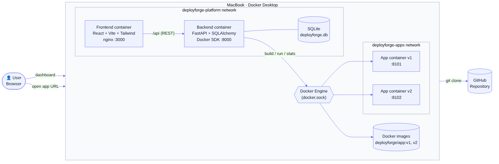
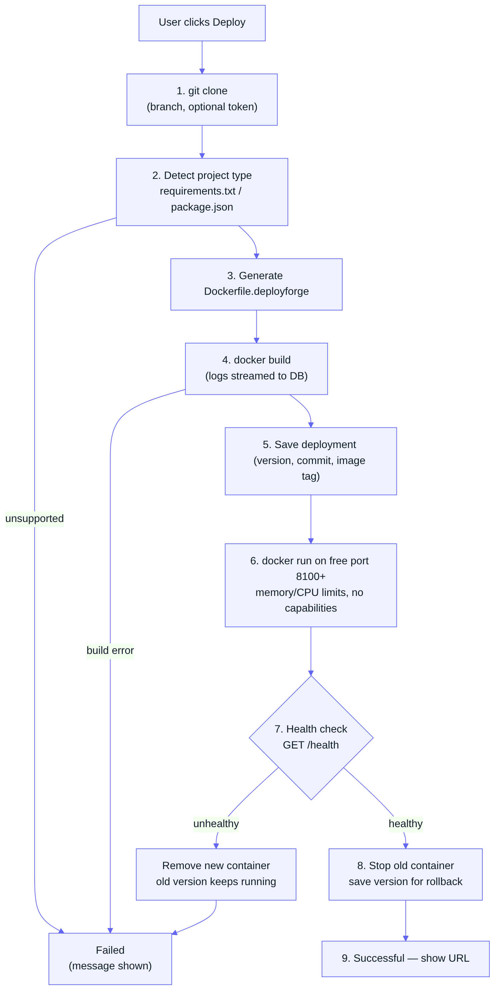
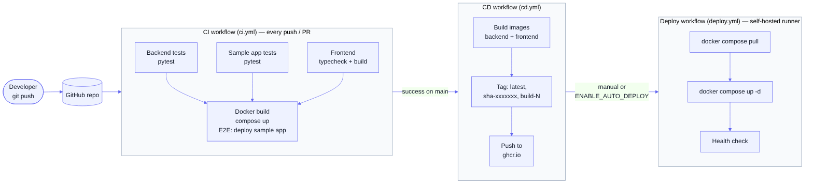

**Team members:** Member 1 (Frontend) · Member 2 (Backend & Database) · Member 3 (GitHub Integration & Detection) · Member 4 (Docker & CI/CD) · Member 5 (Deployment, Monitoring, Rollback & Testing)

_(Replace "Member 1 … 5" with your names and USNs before submitting.)_

# Abstract

Deploying a software application involves many manual steps: writing a Dockerfile, installing
dependencies, building an image, starting a container, choosing a port and checking that the application
works. For students and small teams these steps are time-consuming and error-prone. DeployForge is a mini
Platform as a Service (PaaS) that automates this process on a single computer. The user connects a GitHub
repository through a web dashboard; DeployForge clones the code, automatically detects whether it is a Python
or Node.js project, generates a suitable Dockerfile, builds a Docker image using the Docker SDK for Python,
runs it in an isolated container on a free local port, performs a health check and displays the application
URL. Every deployment is recorded with its version, commit, build logs and status, and earlier healthy
versions can be restored with a real rollback. The platform itself is containerised with Docker Compose and is
continuously integrated and delivered with GitHub Actions, including an end-to-end test that deploys a sample
application inside the CI pipeline. The project is built with React, TypeScript, Tailwind CSS, FastAPI,
SQLAlchemy and SQLite.

# 1. Introduction

Modern software teams use DevOps practices so that code moves quickly and safely from a developer's laptop to
a running system. Two key ideas are **containerisation** — packaging an application with everything it needs
so it runs the same everywhere — and **CI/CD**, where every change is automatically built, tested and
packaged.

Commercial platforms such as Heroku, Render, Railway and Vercel offer this as a service: the developer pushes
code and the platform deploys it. These services are excellent, but they hide how deployment works and their
free tiers are limited. DeployForge implements the core ideas of such a platform in a small, understandable
code base that runs on a MacBook with Docker Desktop. Building it allowed our team to learn Git-based
collaboration, Docker, Docker Compose, REST APIs, databases, automated testing and GitHub Actions in one
project.

# 2. Problem Statement

Students and small development teams often face difficulties deploying applications because they need to
configure Dockerfiles, manage dependencies, create CI/CD pipelines and handle deployment errors. There is no
simple, local, free tool that takes a GitHub repository and turns it into a running, monitored application
while showing each step clearly.

DeployForge aims to simplify this process by providing a centralised dashboard where users connect a GitHub
repository and deploy it with one click. The platform automatically identifies the project type, prepares the
Docker configuration, builds the application, launches it inside a Docker container and displays its status,
logs and health, with basic rollback.

# 3. Objectives

1. To build a web dashboard where a user can connect a GitHub repository (public or private) and choose a branch.
2. To automatically detect the project type (Python, Node.js) from its files.
3. To automatically generate a Dockerfile for the detected type.
4. To build a real Docker image and capture its build logs.
5. To run the application in an isolated container on an available local port and verify it with a health check.
6. To store deployment history and allow rollback to an earlier working version.
7. To manage and monitor containers (start, stop, restart, logs, CPU, memory, health).
8. To containerise the platform with Docker Compose and automate testing, building and publishing with GitHub Actions.

# 4. Existing System

| Approach                                                           | Limitations                                                                                                      |
| ------------------------------------------------------------------ | ---------------------------------------------------------------------------------------------------------------- |
| Manual deployment (write Dockerfile, `docker build`, `docker run`) | Requires Docker knowledge; easy to make mistakes; no history, no rollback, no dashboard                          |
| Cloud PaaS (Heroku, Render, Railway, Vercel)                       | Needs internet and an account; free tiers are limited or removed; internals are hidden, so little learning value |
| Kubernetes-based platforms                                         | Very powerful but complex to install and understand; far beyond a single-laptop use case                         |
| CI/CD only (GitHub Actions)                                        | Builds and tests code but does not by itself run, monitor or roll back an application                            |

# 5. Proposed System

DeployForge is a self-hosted mini PaaS with these properties:

- **One-click deployment** from a GitHub URL, branch and optional token.
- **Automatic detection and Dockerfile generation**, so no Docker knowledge is required from the user.
- **Real Docker operations** through the Docker SDK — nothing is simulated.
- **Safe switch-over:** a new version replaces the old one only after it passes a health check.
- **Version history and rollback** using images that are already built.
- **Monitoring** of status, CPU, memory, health and logs.
- **DevOps for the platform itself:** Docker Compose, CI with an end-to-end deployment test, CD to GitHub
  Container Registry, and a deploy workflow.
- **Simple and local:** SQLite, no paid services, runs on a MacBook.

# 6. System Architecture



The system has four parts:

1. **Frontend (React)** — a single-page dashboard served by nginx on port 3000. It calls the backend's REST API.
2. **Backend (FastAPI)** — on port 8000. It contains the deployment pipeline, talks to GitHub with `git`, to
   the database with SQLAlchemy, and to the Docker Engine with the Docker SDK.
3. **Database (SQLite)** — stores applications, deployments, build logs and versions.
4. **Docker Engine** — builds images and runs the deployed applications. The platform containers are on the
   `deployforge-platform` network; deployed applications run on a separate `deployforge-apps` network.

## 6.1 Deployment flow



## 6.2 CI/CD flow



## 6.3 Database design

| Table               | Purpose                               | Key fields                                                                                                                                                          |
| ------------------- | ------------------------------------- | ------------------------------------------------------------------------------------------------------------------------------------------------------------------- |
| applications        | One row per connected repository      | id, name, repo_url, branch, root_directory, github_token, project_type, current_deployment_id, current_url                                                          |
| deployments         | One row for every deploy or rollback  | id, application_id (FK), version, commit_id, dockerfile, image_tag, container_name, host_port, url, build_status, status, health_status, error_message, is_rollback |
| build_logs          | Each log line of a deployment         | id, deployment_id (FK), step, message, level, created_at                                                                                                            |
| deployment_versions | Healthy images available for rollback | id, application_id (FK), deployment_id (FK), version, image_tag, commit_id                                                                                          |

One application has many deployments; one deployment has many build log lines; a deployment version is
created only when a deployment builds and passes its health check.

# 7. Technology Stack

| Layer           | Technology                                    | Reason for choice                                                |
| --------------- | --------------------------------------------- | ---------------------------------------------------------------- |
| Frontend        | React, TypeScript, Vite, Tailwind CSS         | Component-based UI, type safety, fast builds, consistent styling |
| Backend         | Python, FastAPI, Uvicorn                      | Simple syntax, automatic validation and API docs                 |
| Database        | SQLite + SQLAlchemy                           | Zero setup, single file, ORM instead of raw SQL                  |
| Containers      | Docker, Docker Compose, Docker SDK for Python | Industry standard, runs locally, scriptable from Python          |
| Version control | Git, GitHub                                   | Team collaboration with branches and pull requests               |
| CI/CD           | GitHub Actions, GitHub Container Registry     | Free for repositories, integrated with GitHub                    |
| Testing         | Pytest                                        | Simple, readable tests                                           |

# 8. Module Description

**Module 1 – Dashboard.** Shows total applications, successful and failed deployments, running containers, a
7-day deployment chart, recent activity and the status of each application. Data refreshes every five seconds.

**Module 2 – GitHub Repository Integration.** The user enters a repository URL, branch (branches can be loaded
with `git ls-remote`), an optional Personal Access Token and an optional root directory. The backend validates
the URL and branch name and clones only the latest commit (`git clone --depth 1`). The token is inserted into
the HTTPS URL for cloning and removed from logs and from the clone's configuration afterwards.

**Module 3 – Automatic Project Detection.** `requirements.txt` identifies Python; the framework (Flask with
gunicorn, FastAPI with uvicorn, Django, or plain Python) decides the start command. `package.json` identifies
Node.js; the `start` script or the `main` file decides the start command. `pom.xml` or `build.gradle` is
detected as Java and reported as a future enhancement.

**Module 4 – Dockerfile Generation.** A readable template is filled in for the detected type: base image
(`python:3.12-slim` or `node:20-alpine`), dependency installation first (for layer caching), copying the code,
switching to a non-root user, exposing the port and the start command. The file is saved as
`Dockerfile.deployforge` and shown in the interface.

**Module 5 – Application Building.** When Deploy is clicked, the backend creates a deployment record and runs
the pipeline in the background: fetch, detect, generate, `docker build` (each output line is stored as a build
log), start container, health check, and result. The interface polls for new log lines and shows a step
progress bar.

**Module 6 – Docker Container Management.** Containers created by DeployForge carry the label
`deployforge.managed=true` and unique names (`deployforge-<app>-<version>-d<id>`). Users can list them, view
status and logs, and start, stop and restart them. Containers without the label cannot be controlled.

**Module 7 – Application Deployment.** The new container gets the first free host port in the range 8100–8199
and the URL `http://localhost:<port>`. Only after it passes the health check is the old container stopped and
the new URL shown, with an "Open application" button.

**Module 8 – Deployment History.** Stores and displays deployment ID, application, version (v1, v2 …),
commit ID, date and time, build status, deployment status and URL. Status labels are Pending, Building,
Deploying, Successful, Failed, Replaced and Rolled Back.

**Module 9 – Rollback.** Every version that built and passed its health check is stored in
`deployment_versions` with its image tag. Rolling back creates a new deployment that starts the stored image in
a new container, checks its health and then stops the current container, which is marked Rolled Back. No clone
or build is needed.

**Module 10 – Monitoring.** For each deployed container the page shows running/stopped status, CPU percentage
and memory usage (from `container.stats()`, using the same formula as `docker stats`), a live HTTP health check
and recent logs.

# 9. Implementation

## 9.1 Backend

The backend is organised as routers (HTTP endpoints) and services (logic):

- `github_service.py` runs `git` through `subprocess` with an argument list (not a shell), which avoids command injection.
- `detector.py` and `dockerfile_generator.py` are plain Python functions, which makes them easy to test.
- `docker_service.py` uses `client.api.build(..., decode=True)` to stream build output, and
  `client.containers.run(...)` with `mem_limit`, `nano_cpus`, `pids_limit`, `cap_drop=["ALL"]` and
  `security_opt=["no-new-privileges:true"]`.
- `deployment_service.py` contains the pipeline. Example of the safe switch-over logic:

```python
healthy = health_checker.wait_until_healthy(host_port, ...)
if not healthy:
    docker_service.remove_container_if_exists(container_name)   # remove only the NEW container
    raise DeploymentError("Health check failed. The previous version is still running.")
# healthy: now stop the previous version and make this one live
```

- Login uses an HMAC-signed token (`username:expiry:signature`) checked by a FastAPI dependency.

## 9.2 Frontend

Nine pages (Login, Dashboard, Projects, Connect Repository, Create Deployment, Build Logs, Deployment History,
Monitoring, Settings) share a sidebar layout. A 40-line router based on the History API avoids an extra
library. `api.ts` wraps all REST calls and adds the login token. Status badges use consistent colours (green
successful, blue building, red failed, amber rolled back).

## 9.3 Docker and Docker Compose

- `backend/Dockerfile`: Python 3.12 slim image with `git`, dependencies, a container health check and Uvicorn.
- `frontend/Dockerfile`: multi-stage build — Node builds the React app, nginx serves it and forwards `/api` to the backend.
- `docker-compose.yml`: backend and frontend containers, a named volume for the database, the Docker socket
  mounted **only** into the backend, `host.docker.internal` for health checks, and labels
  `deployforge.role=platform`.

## 9.4 CI/CD

- **CI (`ci.yml`)** runs on every push and pull request: backend tests, sample-app tests, frontend type check
  and build, then Docker image build, `docker compose up`, and an end-to-end script that logs in, creates an
  application for this repository's `sample-app`, deploys it, waits for success and calls the deployed
  container's `/health`.
- **CD (`cd.yml`)** runs after CI succeeds on `main`: builds multi-architecture images, tags them `latest`,
  `sha-<commit>` and `build-<number>` and pushes them to GitHub Container Registry using the built-in
  `GITHUB_TOKEN`.
- **Deploy (`deploy.yml`)** runs on a self-hosted runner and updates the running platform with
  `docker compose pull` and `docker compose up -d`, followed by a health check.

# 10. Testing

| Test file                      | What it checks                                                                                                                                                                                                                                 |
| ------------------------------ | ---------------------------------------------------------------------------------------------------------------------------------------------------------------------------------------------------------------------------------------------- |
| `test_detector.py`             | Flask, FastAPI, plain Python, Node.js (with and without lock file), invalid package.json, Java, unknown                                                                                                                                        |
| `test_dockerfile_generator.py` | Contents of Python and Node Dockerfiles, build step, unsupported types, existing Dockerfile not overwritten                                                                                                                                    |
| `test_github_service.py`       | Valid/invalid URLs, branch validation (including injection attempts), token hiding, root directory escape, cloning a real local git repository                                                                                                 |
| `test_stats.py`                | CPU and memory formula                                                                                                                                                                                                                         |
| `test_auth.py`                 | Valid, tampered and expired tokens                                                                                                                                                                                                             |
| `test_api.py`                  | Login, protected routes, create/list/delete applications, successful deployment, build failure, health-check failure keeping the old version, second deployment replacing the first, rollback, rollback with a missing image, dashboard counts |
| `sample-app/tests/test_app.py` | Homepage, `/health`, `/api/info`, `/api/greet`                                                                                                                                                                                                 |
| `scripts/e2e_test.sh` (in CI)  | Real end-to-end deployment through Docker                                                                                                                                                                                                      |

API tests replace Docker and `git` with small fakes (in `conftest.py`) so they run in seconds on any machine;
the real Docker path is verified by the end-to-end job in CI and in the live demonstration.

_Add here a screenshot of `pytest -v` output and of the green GitHub Actions run from your own machine._

# 11. Results

_Fill this section with your own observations and screenshots after running the project — do not copy
numbers from elsewhere._ Suggested evidence:

1. Screenshot of the dashboard after several deployments.
2. Screenshot of the Build Logs page during and after a successful build.
3. Output of `docker images | grep deployforge` and `docker ps` showing platform and application containers.
4. The sample application v1 and v2 in the browser.
5. Deployment History after a rollback (v2 marked Rolled Back, v1 live again).
6. Monitoring page with CPU and memory values.
7. GitHub Actions: green CI run (with the end-to-end deployment step) and CD run; the published packages.
8. Measured times on your MacBook: first deployment (with base-image download), later deployments, rollback.

# 12. Future Scope

- Deploy to a public cloud virtual machine with a domain name and HTTPS.
- Automatic deployment on `git push` using GitHub webhooks.
- Java (Maven/Gradle) and other languages.
- Environment variables and secrets per application.
- Multiple users with roles, and a build queue.
- Zero-downtime switching with a reverse proxy (e.g. stable URLs per application).
- Alerts when an application becomes unhealthy.

# 13. Conclusion

DeployForge shows, in a small and understandable code base, how a Platform as a Service works: source code
from GitHub is turned into a Docker image and a running, health-checked container, with history, monitoring
and rollback. The project uses real Docker operations through the Docker SDK and a real CI/CD pipeline that
tests, builds, deploys end-to-end and publishes the platform. Working on it as a team of five gave us practical
experience with collaborative development on GitHub, containerisation, automation and testing — the core
skills of Continuous Collaborative Development and DevOps.

# References

1. Docker Documentation — <https://docs.docker.com/>
2. Docker SDK for Python — <https://docker-py.readthedocs.io/>
3. FastAPI Documentation — <https://fastapi.tiangolo.com/>
4. SQLAlchemy Documentation — <https://docs.sqlalchemy.org/>
5. GitHub Actions Documentation — <https://docs.github.com/actions>
6. React Documentation — <https://react.dev/>
7. Tailwind CSS Documentation — <https://tailwindcss.com/docs>
